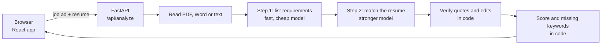

# JobFit

**Check your resume against any job ad, with proof.**
JobFit lists what the job asks for, shows which requirements your resume meets, and quotes the line in your resume that proves each one. Suggested edits start from your own lines and never invent experience. Works with English and Chinese job ads and resumes.

[中文说明](README.zh-CN.md) · [Roadmap](ROADMAP.md)


<p>
  
  
</p>

<sub>Screenshots are from the offline demo mode, which uses keyword matching instead of an AI model.</sub>

## What you get

- **Every requirement checked**: met, partly met or missing, split into must-haves and nice-to-haves.
- **A quote for every match**, highlighted, copied from your resume.
- **Words the ad uses that your resume never does**, the terms recruiters and screening software search for.
- **Suggested edits** that rephrase your existing lines, with `[placeholders]` for numbers only you know.
- **A work-rights flag** when the ad asks for citizenship, residency, sponsorship or a security clearance.
- **Results explained in English or Chinese**, whatever language the documents are in.

## How it stays honest

Language models are fluent and sometimes wrong. JobFit treats the model's answer as a draft and checks it in code before anything reaches the user.

| Problem | What JobFit does |
| --- | --- |
| The model "quotes" a line that isn't in the resume | Every quote is searched for in the resume (ignoring case, punctuation and line breaks; Chinese text is matched without word boundaries). Quotes that aren't found are removed, and a requirement left with no evidence is counted as missing. |
| A suggested edit slips in a skill the candidate doesn't have | An edit is dropped if its original line isn't in the resume, or if the rewrite mentions a skill from the job ad that the resume never mentions. |
| A score that changes from run to run | The model only labels each requirement. The score is a fixed formula in code: met = 1, partly met = 0.5, must-haves weigh 75% and nice-to-haves 25%. |
| A job ad that says "ignore your instructions" | Both documents are wrapped in tags and the model is told to treat them as data, never as instructions. |

The results page tells the user how much was removed ("1 of 9 quotes could not be found in your resume…"), so the checking is visible, not hidden.

## How it works



- **Two steps, two models.** Listing requirements is easy, so it uses a fast model; matching needs careful reading, so it uses a stronger one. This keeps each analysis cheap and quick.
- **Any provider.** Claude (with [structured outputs](https://platform.claude.com/docs/en/build-with-claude/structured-outputs), so the reply always fits the schema) or DeepSeek (JSON mode, validated with Pydantic and retried once with the validation error). An offline keyword-matching mode needs no API key and powers the tests, CI and the free demo.
- **Nothing is stored.** Files are read in memory and discarded after the response. There are no accounts and no database.
- **Cost guards.** A per-visitor hourly limit and a site-wide daily limit stop a public deployment from running up a bill.

| Part | Stack |
| --- | --- |
| Backend | Python 3.11+, FastAPI, Pydantic, pypdf, python-docx, Anthropic and OpenAI-compatible SDKs |
| Frontend | React 19, TypeScript, Vite, plain CSS, English/Chinese interface |
| Quality | pytest (60+ tests), an evaluation set, GitHub Actions, Docker smoke test |

## Run it locally

You need Python 3.11+ and Node 22+.

```bash
# 1. Backend (http://localhost:8000)
cd backend
python -m venv .venv
source .venv/bin/activate          # Windows: .venv\Scripts\activate
pip install -e ".[dev]"
uvicorn jobfit.main:create_app --factory --reload
```

That starts in **demo mode**. To use a real model, copy `.env.example` to `.env` in the project root, add `ANTHROPIC_API_KEY` or `DEEPSEEK_API_KEY`, and start the server with `--env-file ../.env`.

```bash
# 2. Frontend (http://localhost:5173), in a second terminal
cd frontend
npm install
npm run dev
```

The Vite dev server forwards `/api` to the backend.

### Run everything in one container

```bash
docker build -t jobfit .
docker run -p 8000:8000 --env-file .env jobfit     # open http://localhost:8000
```

## Configuration

All settings are environment variables; see [`.env.example`](.env.example).

| Variable | Default | Purpose |
| --- | --- | --- |
| `ANTHROPIC_API_KEY` / `DEEPSEEK_API_KEY` | none | Which AI provider to use. With neither, demo mode. |
| `JOBFIT_PROVIDER` | from the keys | Force `anthropic`, `deepseek` or `mock`. |
| `JOBFIT_EXTRACT_MODEL` / `JOBFIT_MATCH_MODEL` | provider default | Claude: `claude-haiku-5-5` / `claude-sonnet-5-5`. DeepSeek: `deepseek-flash`. |
| `JOBFIT_EXTRACT_EFFORT` / `JOBFIT_MATCH_EFFORT` | `low` / `medium` | Claude's thinking effort for each step. |
| `JOBFIT_RATE_LIMIT_PER_HOUR` | `10` | Analyses per visitor per hour. `0` turns it off. |
| `JOBFIT_DAILY_ANALYSIS_LIMIT` | `200` | Analyses for the whole site per day. `0` turns it off. |
| `JOBFIT_MAX_UPLOAD_BYTES` | `2000000` | Largest resume file accepted. |

## Tests and evaluation

```bash
cd backend
pytest -q                     # unit and API tests, no network needed
python -m evals.run_evals     # the evaluation set with the current provider
```

`evals/cases/` holds invented job ads and resumes from Australia, the UK, the US and China, each with the statuses a careful human reviewer would expect. The runner reports status accuracy, work-rights accuracy and the share of cited quotes that were really in the resume.

| Provider | Status accuracy | Work rights | Quotes found in resume | Time per analysis | Tokens per analysis |
| --- | --- | --- | --- | --- | --- |
| Demo mode (keyword matching) | 68.2% (15/22) | 4/4 | 100% | under 0.1s | none |
| DeepSeek, `deepseek-flash` for both steps | 95.5% (21/22)* | 4/4 | 100% (32/32) | 17.2s | about 2,200 in, 2,800 out |
| Claude | not measured yet | | | | |

\* Measured on 29 October 2026. Its one miss was a labelling error in the eval set: the resume had Tableau where the ad asked for Power BI, and the matching rubric counts a similar tool as *partly met*, which is what DeepSeek answered. The label has since been corrected. Four cases is a small set, so treat these numbers as a first signal; growing the set is on the [roadmap](ROADMAP.md).

At DeepSeek's published `deepseek-flash` prices (peak: ¥2 per million input tokens, ¥8 per million output tokens; half that off-peak), one analysis costs about ¥0.03 at peak.

Real-model runs happen in GitHub Actions with the API key stored as a repository secret: **Actions → Evaluate with a real model → Run workflow**. Each run posts its report to the *Evaluation results* issue.

## Project layout

```
backend/
  jobfit/
    main.py          HTTP API
    pipeline.py      the two steps plus verification
    grounding.py     "is this quote really in the resume?"
    scoring.py       the score formula
    parsing.py       PDF / Word / text to plain text
    prompts.py       prompts for both steps
    llm/             Claude, DeepSeek and offline demo providers
  tests/             pytest suite
  evals/             evaluation cases and runner
frontend/
  src/               React app (App, components, i18n, API client)
```

## Licence

[MIT](LICENSE)
