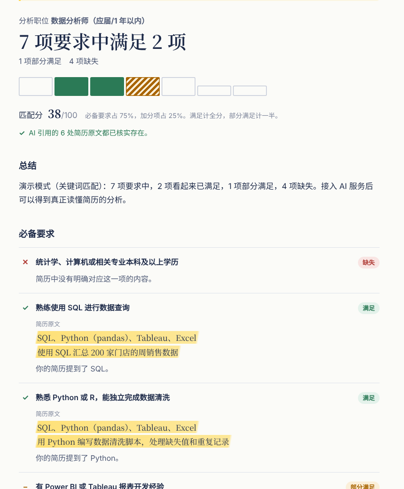
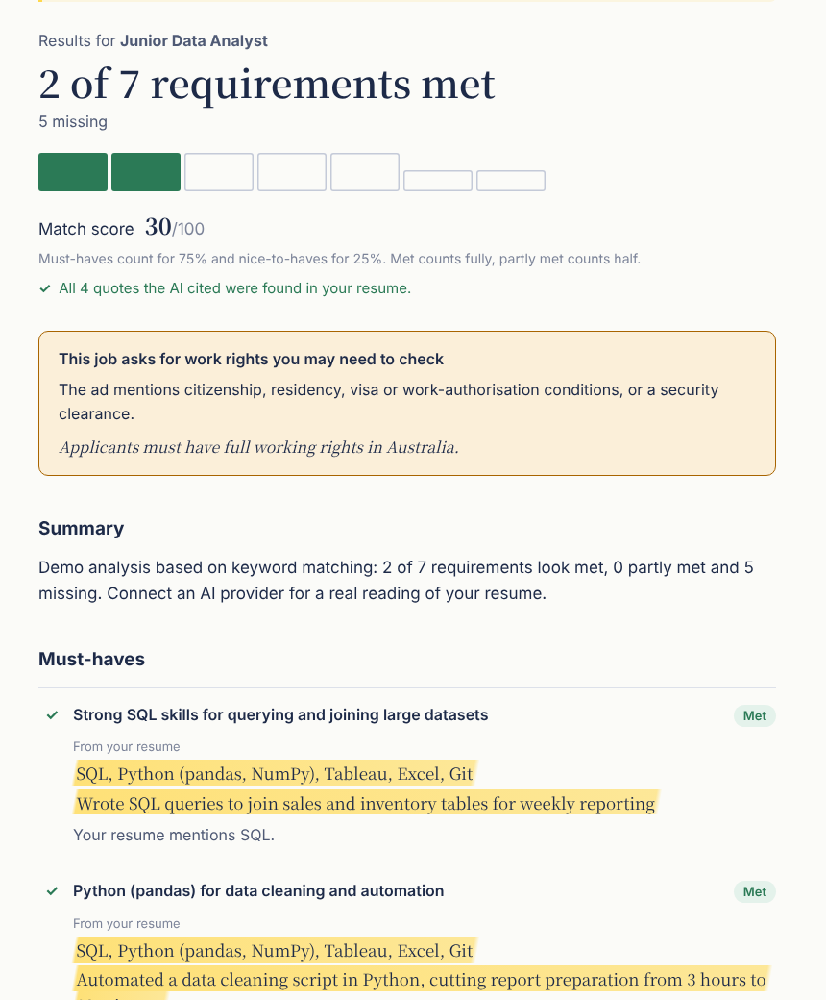
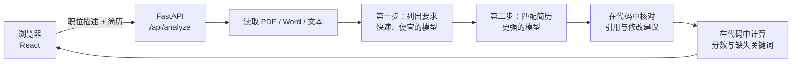

# JobFit

**对照任意职位描述检查你的简历，每一条结论都有依据。**
JobFit 会列出职位的全部要求，标出你的简历满足了哪些，并为每个"满足"附上简历中的原句作为证据。修改建议都从你简历里已有的句子出发，绝不编造经历。支持中文和英文的职位描述与简历。

[English](README.md) · [路线图](ROADMAP.md)

<p>
  
  
</p>

<sub>截图来自离线演示模式（关键词匹配，未使用 AI 模型）。</sub>

## 能做什么

- **逐条核对每一项要求**：满足、部分满足或缺失，并区分必备要求和加分项。
- **每个"满足"都有原文**：从简历中摘出、高亮显示。
- **职位描述里有、简历里从未出现的词**：招聘方和简历筛选系统常常直接搜索这些词。
- **修改建议**：改写你已有的句子，需要你补充的数字用 `[占位符]` 标出。
- **工作身份提醒**：职位要求国籍、居留、签证担保或安全审查时会单独提示。
- **结果说明可选中文或英文**，与简历本身的语言无关。

## 如何保证不"胡说"

大模型表达流畅，但偶尔会出错。JobFit 把模型的回答当作草稿，先在代码里核对，再展示给用户。

| 问题 | JobFit 的做法 |
| --- | --- |
| 模型"引用"了简历里根本没有的句子 | 每一处引用都会回到简历中查找（忽略大小写、标点和换行；中文不要求词边界）。找不到的引用会被删除；没有证据剩下的要求按"缺失"计算。 |
| 修改建议里混进了候选人没有的技能 | 如果原句不在简历里，或者改写后出现了职位描述中有、简历中从未提到的技能，这条建议会被删除。 |
| 每次运行分数都不一样 | 模型只负责给每条要求打标签，分数由代码里的固定公式计算：满足 = 1，部分满足 = 0.5；必备要求占 75%，加分项占 25%。 |
| 职位描述里写着"忽略你的指令" | 两份文档都用标签包起来，并明确告诉模型：这是数据，不是指令。 |

结果页会直接告诉用户删掉了多少内容（例如"AI 引用的 9 处原文中，有 1 处在你的简历里找不到"），让核对过程看得见。

## 工作原理



- **两步、两个模型**：列出要求比较简单，用快模型；匹配需要仔细阅读，用更强的模型。成本低、速度快。
- **可切换的 AI 服务**：Claude（使用[结构化输出](https://platform.claude.com/docs/en/build-with-claude/structured-outputs)，回答一定符合数据格式）或 DeepSeek（JSON 模式，用 Pydantic 校验，不合格时附上错误信息自动重试一次）。另有无需 API Key 的离线演示模式，用于测试、CI 和免费体验。
- **不保存任何数据**：文件只在内存中读取，响应后即丢弃。没有账号，也没有数据库。
- **成本保护**：每位访客每小时有次数上限，全站每天也有总上限，防止公开部署后账单失控。

## 本地运行

需要 Python 3.11+ 和 Node 22+。

```bash
# 1. 后端（http://localhost:8000）
cd backend
python -m venv .venv
source .venv/bin/activate          # Windows：.venv\Scripts\activate
pip install -e ".[dev]"
uvicorn jobfit.main:create_app --factory --reload
```

这样启动的是**演示模式**。要使用真实模型：把项目根目录的 `.env.example` 复制为 `.env`，填入 `ANTHROPIC_API_KEY` 或 `DEEPSEEK_API_KEY`，启动命令加上 `--env-file ../.env`。

```bash
# 2. 前端（http://localhost:5173），另开一个终端
cd frontend
npm install
npm run dev
```

用 Docker 一键运行：

```bash
docker build -t jobfit .
docker run -p 8000:8000 --env-file .env jobfit     # 打开 http://localhost:8000
```

全部配置项见 [`.env.example`](.env.example) 和英文 README 中的配置表。

## 测试与评测

```bash
cd backend
pytest -q                     # 单元测试和接口测试，无需联网
python -m evals.run_evals     # 用当前 AI 服务跑评测集
```

`evals/cases/` 里是虚构的职位描述和简历（澳洲、英国、美国、中国），每份都标好了人工预期结果。目前离线演示模式的要求判断准确率为 72.7%（16/22），这是真实模型需要超越的基线；Claude 与 DeepSeek 的结果待测。

## 许可证

[MIT](LICENSE)
